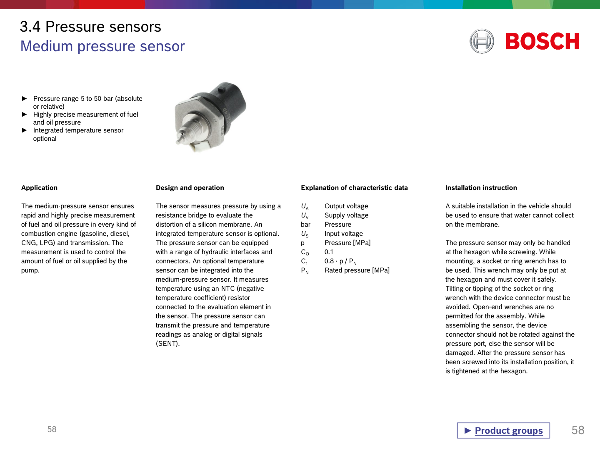
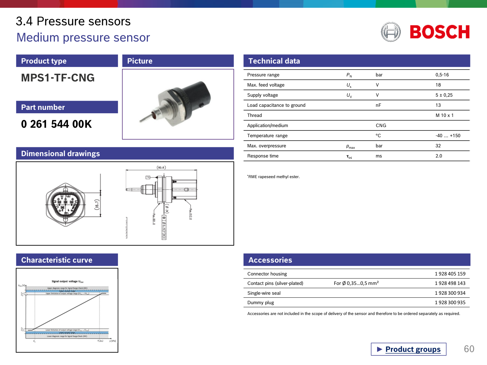

# MPS1-TF-CNG Characteristic Curve -- Authoritative Determination

**Date:** 2026-07-16
**Status:** Verified against Bosch source material

---

## Source Evidence

The transfer function is defined in the Bosch i-business catalog (2025-11-12 edition).

### Source 1: Transfer Function Definition (Catalog Page 58)



The catalog defines the characteristic data for all MPS1 medium pressure sensors:

| Symbol | Meaning | Value |
|--------|---------|-------|
| UA | Output voltage | -- |
| UV | Supply voltage | -- |
| US | Input voltage | -- |
| p | Pressure | [MPa] |
| **C0** | **Offset coefficient** | **0.1** |
| **C1** | **Span coefficient** | **0.8 * p / PN** |
| PN | Rated pressure | [MPa] |

### Source 2: MPS1-TF-CNG Specifications (Catalog Page 60)



Key specifications for the MPS1-TF-CNG (part number **0 261 544 00K**):

| Parameter | Value |
|-----------|-------|
| Pressure range PN | 0.5 -- 16 bar |
| Max. feed voltage Us | 18 V |
| Supply voltage UV | 5 +/- 0.25 V |
| Load capacitance to ground | 13 nF |
| Thread | M10 x 1 |
| Application/medium | CNG |
| Temperature range | -40 to +150 deg C |
| Max. overpressure pmax | 32 bar |
| Response time tau_ini | 2.0 ms |

---

## Derived Characteristic Curve

### Transfer Function (Platform-Level)

The MPS1 platform uses a unified transfer function where each variant is calibrated via its rated pressure P_N:

$$U_{OUT} = (C_1 + C_0) \cdot U_S = \left(0.8 \cdot \frac{p}{P_N} + 0.1\right) \cdot U_S$$

### MPS1-TF-CNG Specific Derivation

For the CNG variant, the catalog specifies $P_N = 16\ \text{bar} = 1.6\ \text{MPa} = 1600\ \text{kPa}$:

$$c_1 = \frac{0.8}{P_N} = \frac{0.8}{1600\ \text{kPa}} = 0.0005\ \text{kPa}^{-1}$$

Substituting into the platform formula:

$$U_{OUT} = (0.0005 \cdot p_{kPa} + 0.1) \cdot U_S$$

### Simplified Form (US = 5.0 V)

$$U_{OUT}[V] = 0.25 \cdot p_{bar} + 0.5$$

**Inverse (pressure from voltage):**

$$p_{bar} = 4 \cdot U_{OUT}[V] - 2$$

$$p_{kPa} = 400 \cdot U_{OUT}[V] - 200$$

### Coefficients Summary

| Coefficient | Symbol | Value | Unit | Source |
|------------|--------|-------|------|--------|
| Offset | C0 | 0.1 | dimensionless | Catalog p.58 |
| Rated pressure | P_N | 16 | bar | Catalog p.60 |
| Rated pressure | P_N | 1600 | kPa | Conversion |
| Gain | c1 | 0.0005 | kPa^-1 | c1 = 0.8 / P_N |
| Sensitivity | -- | 0.25 | V/bar | c1 * US * 100 |
| Sensitivity | -- | 2.5 | mV/kPa | c1 * US |

### Key Transfer Points

| Pressure (bar) | Pressure (kPa) | U_OUT @ US=5.0V (V) |
|:---:|:---:|:---:|
| 0 | 0 | 0.500 |
| 0.5 | 50 | 0.625 |
| 1 | 100 | 0.750 |
| 2 | 200 | 1.000 |
| 3 | 300 | 1.250 |
| 4 | 400 | 1.500 |
| 5 | 500 | 1.750 |
| 6 | 600 | 2.000 |
| 7 | 700 | 2.250 |
| 8 | 800 | 2.500 |
| 9 | 900 | 2.750 |
| 10 | 1000 | 3.000 |
| 11 | 1100 | 3.250 |
| 12 | 1200 | 3.500 |
| 13 | 1300 | 3.750 |
| 14 | 1400 | 4.000 |
| 15 | 1500 | 4.250 |
| 16 | 1600 | 4.500 |

### Full-Scale Output Range

The sensor uses the complete ratiometric output range of the MPS1 platform:

| Range | Symbol | Fraction of US | Voltage @ 5V | Pressure Equivalent |
|-------|--------|:---:|:---:|:---:|
| Lower SRC diagnostic | Usrcl | [0.00 ... 0.04] | 0.00 -- 0.20 V | Fault: short to GND |
| Lower unused | -- | ]0.04 ... 0.06[ | 0.20 -- 0.30 V | Transition |
| Lower clamp | Ucll (C1) | [0.06 ... 0.10] | 0.30 -- 0.50 V | Output limitation |
| **Measurement start** | **Umrb (C2)** | **0.10** | **0.50 V** | **~0 bar** |
| **Measurement end** | **Umre (C3)** | **0.90** | **4.50 V** | **~16 bar** |
| Upper clamp | Uclh (C4) | [0.90 ... 0.94] | 4.50 -- 4.70 V | Output limitation |
| Upper unused | -- | ]0.94 ... 0.96[ | 4.70 -- 4.80 V | Transition |
| Upper SRC diagnostic | Usrch | [0.96 ... 1.00] | 4.80 -- 5.00 V | Fault: short to UB |

**Usable measurement span:** 4.0 V (0.5 V to 4.5 V) corresponding to 0--16 bar.
**Sensitivity:** 0.25 V/bar (2.5 mV/kPa).

---

## Practical Implications

### ADC Resolution (ADS1015 on VentCon2)

With the existing `GAIN_TWOTHIRDS` setting (+/-6.144 V, 3 mV/LSB):

| Metric | Value |
|--------|-------|
| ADC steps across 0--16 bar | 4.0 V / 0.003 V = ~1,333 steps |
| Pressure per ADC step | 16 bar / 1333 = ~0.012 bar |
| Effective resolution | ~12 mbar per LSB |

This is excellent for pressure control -- **no gain switching needed**. The `GAIN_TWOTHIRDS` setting that VentCon2 already uses is perfectly adequate.

### Wiring

| Pin | Function | ESP32 Connection |
|-----|----------|-----------------|
| 1 | GND | GND |
| 2 | NTC (temperature) | Optional -- ADC channel if needed |
| 3 | +5V (supply) | 5V rail |
| 4 | U_OUT (pressure) | ADS1015 AIN0 or ESP32 ADC |

### Calibration Constants for VentCon2

```
Sensor type:           Bosch MPS1-TF-CNG (P/N 0 261 544 00K)
Transfer function:     p_bar = 4.0 * U_V - 2.0
Min voltage:           0.5 V
Max voltage:           4.5 V
Min pressure:          0.0 bar
Max pressure:          16.0 bar
Ratiometric:           Yes (measure Uout/Us ratio for best accuracy)
```

---

## Connector and Accessories

| Accessory | Part Number | Notes |
|-----------|-------------|-------|
| Sensor | 0 261 544 00K | MPS1-TF-CNG |
| Connector housing | 1 928 405 159 | -- |
| Contact pins (silver-plated) | 1 928 498 143 | Wire dia. 0.35--0.5 mm2 |
| Single-wire seal | 1 928 300 934 | -- |
| Dummy plug | 1 928 300 935 | For unused cavities |

*Accessories not included with sensor -- order separately.*

---

*Characteristic curve determined from Bosch i-business catalog (2025-11-12), Section 3.4 Medium Pressure Sensors, cross-validated against MPS1 platform TCD RB 0 261 K00 13H.*
